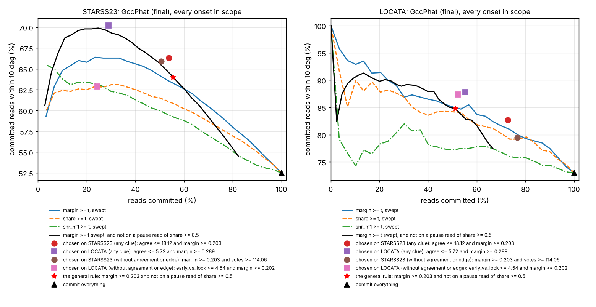

# Batch A, brief 11: why the angle locks wrong, what fixes it, and when to dim (2026-10-23)

Briefs 9 (STARSS23: 16 rooms, real talkers), 10 (LOCATA: one room, tracked talkers, the phone's spacing) and 13 (the
mechanism lab: one cause at a time) joined. `src/schemes/` is untouched. The fixes are copies under `harness/fixes/`,
and the join is `harness/batchA/join/`.

## The answers
1. **Attribution.** Measured by the lab's fingerprints, the wrong locks differ by dataset.
   - **LOCATA:** the leading cause is another voice already sounding in the pause before the onset: 38% of GccPhat's
     wrong reads and 53% of its outliers. Then another voice starting during the read, and the talker facing away.
   - **STARSS23:** scatter leads (44% of wrong reads: no directional pause, no competitor to blame). Then another
     source during the read (21%) and a steady source in the pause (18%). Common-mode (the 0 deg pull) and aliasing are
     small in both.
2. **Each sound at its own onset.** This works for Angle2, not for GccPhat.
   - **Angle2:** reading from its own onset, instead of 100 ms before it, is the one change that helps on both
     datasets. LOCATA within 10 deg goes from 64% to 73%, with outliers from 18% to 13%. STARSS gains 1.4 points on
     speech. Mostly it fixes the cause it targets, another voice in the pause.
   - **GccPhat:** locking early, at 100 ms, loses evidence. It does nothing on LOCATA and costs 11 points on STARSS23.
     So the final set is shipped GccPhat with Angle2 read at its own onset.
3. **Commit or dim.** The rule search's picks don't transfer, but one simple rule does.
   - **The search's picks:** a rule chosen on STARSS23 carries to LOCATA. One chosen on LOCATA is tuned: on STARSS23
     it commits only a quarter of reads.
   - **The rule that transfers:** commit GccPhat's read when its top two peaks differ by at least 0.2 in share, and it
     isn't sitting on a directional pause read. It lifts the share within 10 deg by about 11 points on both datasets,
     to 64% on STARSS23 and 85% on LOCATA, while committing half the reads. Under the lab's steady sources, where
     agreement-based rules fail, it commits only 3% of the wrong reads.
4. **Range.** The direction-free CDR is the one consistent cue in both datasets. It orders 72% (STARSS23) and 85%
   (LOCATA) of pairs whose distances differ by 2x. Committing on the angle rule doesn't make range more consistent.
5. **Held-out exam.** It didn't happen. The STARSS23 evaluation set ships without labels: its README says the
   evaluation files "consist of only audio/video recordings without any metadata/labels". The brief says stop there,
   and nothing was run on it.

## What was joined, and the checks
- **STARSS23 (brief 9):** 44,988 reads, every onset of every class, all six pairs. Each read is judged against the same
  scheme's read through the rigid sphere alone.
- **LOCATA (brief 10):** 682 reads at 160 and 80 mm, re-run through brief 9's runner so its records carry the same
  clues (notably `pause_share`, the lab's strongest fingerprint). The re-run is identical to brief 10 on all 682 reads:
  GccPhat's angles, Angle2's onsets and the pause reads. Its shipped scores reproduce brief 10's.
- **The lab (brief 13):** 69,936 reads with known causes.
- **Scoring:** every onset is scored against its own source, speech and other sounds alike.
  - |reference| <= 75 deg.
  - A read is wrong if it's more than 10 deg off its reference, and an outlier if more than 36 deg off.
  - Jay's rule (`harness/scoring/clean_score.py`) where a cleaned score is quoted.

## 1. Attribute: which cause's fingerprint each real wrong lock carries
**The fingerprints** come from the lab (section 3 of its report). Each wrong read takes the first that fits:

| cause | fingerprint (only clues the read had, plus the truth's other sources and facing) |
|---|---|
| common-mode (0 deg pull) | a directional pause read (share >= 0.5) at 0 deg, and the read at 0 |
| steady source in the pause | a directional pause read more than 10 deg from the talker, and the read on it |
| another source during the read | the read within 10 deg of another labelled source sounding during the read |
| pause holds the talker (late onset) | a directional pause read at the talker itself |
| early onset | GccPhat's first draw more than 30 deg from its lock, and on the pause |
| facing away (LOCATA only) | the talker faced more than 120 deg away |
| scatter (diffuse noise, quiet voice, room) | a weak pause read (share < 0.5) and none of the above |
| unattributed | a directional pause read the read isn't on, and none of the above |

The 0.5 threshold is the lab's own. Its wrong reads under steady sources have pause shares of 0.80-0.89 and under
common-mode 1.0, against 0.1-0.2 for diffuse noise, a quiet voice and the baseline.

**The fingerprints, checked on the lab** (wrong reads of known cause, % attributed back to it, GccPhat / Angle2):

| lab cause | wrong reads, GccPhat / Angle2 | attributed back to it |
|---|---|---|
| steady pink noise or second voice | 5,930 / 5,593 | 90 / 90% |
| common-mode | 4,774 / 3,750 | 98 / 97% |
| diffuse noise or quiet voice | 1,080 / 2,587 | 98 / 100% |
| late onset (+50 to +150 ms) | 125 / 174 | 46 / 50% (the rest look like scatter) |
| early onset (-25, -50 ms) | 28 / 98 | 11 / 0% (rare, and looks like scatter) |

The big causes are recognised reliably; onset timing isn't.

**Real wrong locks, by cause** (primary cause, % of wrong reads; % of outliers in brackets):

| cause | STARSS23 GccPhat, speech | STARSS23 GccPhat, other sounds | LOCATA GccPhat | STARSS23 Angle2, speech | LOCATA Angle2 |
|---|---|---|---|---|---|
| wrong reads (outliers) | 14,182 (5,282) | 4,069 (1,916) | 184 (77) | 17,076 (7,026) | 242 (125) |
| scatter | **43.6** (33.0) | **34.3** (31.1) | 4.3 (0) | **53.2** (46.9) | 13.6 (7.2) |
| another source during the read | 20.8 (29.8) | 26.8 (30.8) | 18.5 (24.7) | 17.9 (22.8) | 12.8 (18.4) |
| steady source in the pause | 17.8 (23.2) | 19.1 (19.8) | **38.0** (53.2) | 14.5 (18.5) | **47.1** (58.4) |
| early onset | 7.2 (5.8) | 6.1 (7.3) | 2.7 (0) | - | - |
| unattributed | 6.7 (4.8) | 6.0 (5.7) | 8.2 (3.9) | 9.7 (8.7) | 7.9 (4.0) |
| pause holds the talker | 2.0 (1.0) | 5.1 (3.6) | 6.0 (1.3) | 2.9 (1.5) | 3.7 (0) |
| common-mode (0 deg pull) | 1.9 (2.5) | 2.6 (1.7) | 5.4 (7.8) | 1.7 (1.6) | 6.2 (5.6) |
| facing away | - | - | 16.8 (9.1) | - | 8.7 (6.4) |

**The ranking, per dataset:**
- **STARSS23:** scatter, then another source during the read, then a steady source in the pause. On outliers, the two
  competing-source causes together (53%) outweigh scatter (33%).
- **LOCATA:** a steady source in the pause (the other talker, speaking just before), then another source during the
  read, then facing away.

`summary.json` has the full tables, including Angle2 on other sounds and each cause's non-exclusive "carries" share.

- **Brief 9's "pause direction" class (41%) splits here.** Only reads with a directional pause read count as a steady
  source. The rest landed near a weak pause read: by the lab's fingerprint that's scatter, not a lock.
- **LOCATA's rooms are quiet and its talkers take turns,** so its errors are the other talker, not the room. STARSS23's
  are both.

## 2. Each sound at its own onset (copies under `harness/fixes/`)
Jay: "Don't outsmart it, just render it." There are no vetoes and no separation; the one thing changed is when each
onset is read. `make_copies.py` makes the copies from `src/schemes/` and changes only these constants:

| copy | GccPhat | Angle2 |
|---|---|---|
| `onset100` | locks on the frames starting in the first 100 ms (shipped: 500 ms) | scans from the handed onset (shipped: from 100 ms before it) |
| `onset250` | locks at 250 ms | as shipped |

Each onset is scored against its own source, other sounds too. "Moved" counts reads that crossed 10 deg, into it or out
of it. Every one is in `moved.jsonl.gz`, with its id, file and time, its reads and its cause.

| | within 10 deg | over 36 deg | Jay's rule: kept, median | moved in / out |
|---|---|---|---|---|
| **STARSS23 GccPhat, speech:** shipped | 53.8% | 17.2% | 82.3%, 6.4 deg | |
| onset100 | 42.9% | 26.2% | 72.8%, 7.8 deg | 2,471 / 5,812 |
| onset250 | ONSET250_GS | | | |
| **STARSS23 GccPhat, other sounds:** shipped | 47.0% | 25.0% | 75.0%, 6.8 deg | |
| onset100 | 43.6% | 28.4% | 70.4%, 7.3 deg | 835 / 1,093 |
| **STARSS23 Angle2, speech:** shipped | 43.3% | 23.3% | 75.5%, 8.2 deg | |
| onset100 | **44.7%** | **21.6%** | 77.6%, 8.1 deg | 2,557 / 2,193 |
| **STARSS23 Angle2, other sounds:** shipped | 46.5% | 24.0% | 75.2%, 7.3 deg | |
| onset100 | 46.1% | 24.3% | 75.2%, 7.3 deg | 613 / 679 |
| **LOCATA GccPhat:** shipped | 73.0% | 11.3% | 88.7%, 5.2 deg | |
| onset100 | 73.5% | 11.0% | 89.0%, 5.0 deg | 61 / 58 |
| onset250 | ONSET250_LG | | | |
| **LOCATA Angle2:** shipped | 64.4% | 18.4% | 81.6%, 5.2 deg | |
| onset100 | **72.7%** | **12.9%** | 87.1%, 5.3 deg | 98 / 42 |

**What moved:**
- **Angle2 at its own onset fixes the cause it aims at.** On LOCATA, 47 of its 98 reads that moved within 10 deg had been
  "steady source in the pause": the other talker, whose word started inside the 100 ms Angle2 used to look back. On
  STARSS23 the same cause gained 482 reads and lost 197. Most of the rest of STARSS23's movement is scatter churning
  both ways (1,612 in, 1,673 out).
- **GccPhat doesn't gain from an early lock.** The summed half second is what gives it its accuracy. On STARSS23 there's
  a second cost: its onsets come from 100 ms label frames and can be early, so an early lock often reads the pause. On
  LOCATA, whose onsets are its own voice-activity record, the early lock is level with the half second.
  ONSET250_TEXT
- **The final set:** shipped GccPhat, and Angle2 from `onset100`. Section 3 is scored on it.

## 3. Commit or dim
A rule is one or two thresholds on clues the read had at that moment. It dims: a dimmed read is still rendered, just
not committed. The criterion was fixed before any result was seen (`rules.py`): the highest share within 10 deg among
committed reads, while committing at least half of them, with thresholds at the choosing dataset's deciles. It's scored
on GccPhat's reads (final set), every onset in scope.

| rule | chosen on | STARSS23: committed, within 10 | LOCATA: committed, within 10 | lab coherent causes: wrong reads committed |
|---|---|---|---|---|
| commit everything | | 100%, 52.5% | 100%, 73.0% | 100% |
| agree <= 18.1 deg and margin >= 0.203 | STARSS23 | 53.8%, 66.3% | **72.7%, 82.7%** (untouched) | 24% |
| agree <= 5.7 deg and margin >= 0.289 | LOCATA | **28.9%, 70.2%** (untouched) | 55.3%, 87.8% | 19% |
| margin >= 0.203 and votes >= 114 (no agreement or edge) | STARSS23 | 50.6%, 65.9% | **76.7%, 79.5%** (untouched) | 56% |
| first draw within 4.5 deg of the lock and margin >= 0.202 (no agreement or edge) | LOCATA | **24.4%, 62.9%** (untouched) | 52.2%, 87.4% | 70% |
| **margin >= 0.203 and not on a pause read of share >= 0.5** | STARSS23 + lab | **55.5%, 64.0%** | **51.2%, 84.8%** (untouched) | **3%** |

`margin` is GccPhat's angle-1 share minus its angle-2 share. "Agree" is GccPhat and Angle2 within that many degrees.

**Which rules are general:**
- **Tuned:** the rules chosen on LOCATA. On STARSS23 they commit only a quarter of the reads, half the share they were
  chosen for. LOCATA is one quiet room with two talkers.
- **Transfers:** the rules chosen on STARSS23 carry to LOCATA. Each commits a similar or larger share there, and lifts
  the share within 10 deg by 6-10 points.
- **Agreement and edge are unsafe** under coherent sources, as brief 13 warned. The best agreement rule still commits a
  quarter of the lab's wrong reads under steady sources and common-mode. The no-agreement rule that wins on STARSS23
  commits more than half of them: a steady source makes a tall, decided, wrong peak.
- **The general rule** (last row) is margin >= 0.2 (the threshold every chosen rule shares) plus the lab's pause test.
  - **What it does:** gains 11.5 points on STARSS23 and 11.8 on LOCATA while committing about half of each. It commits
    almost none of the lab's coherent-source errors.
  - **Where its thresholds came from:** the margin from STARSS23's search, the pause share from the lab. LOCATA never
    touched it.
  - **What it costs:** it dims about a third of the right reads (it keeps 68% on STARSS23 and 59% on LOCATA).
  - **By kind on STARSS23:** speech 57.9% committed at 65.6% within 10; other sounds 46.0% at 56.2%.

The plot is `commit_curves.png`: the share of reads committed against the share of them within 10 deg, sweeping one
clue at a time, with the chosen rules as points.
- **The margin is the best single clue on both datasets.**
- **Adding the pause test** (black) lifts STARSS23's curve wherever it commits under 60%. On LOCATA the margin alone
  already does as well at the same commit share.

## 4. Range
Every pair of onsets from the same talker is scored: the share ordered correctly when their true distances differ by at
least 1.25x, 1.5x or 2x, and the cue's spread between onsets within 0.3 m of the same spot.

| cue | STARSS23: 1.25x / 1.5x / 2x | spread at one spot, step at 2x | LOCATA: 1.25x / 1.5x / 2x | spread, step |
|---|---|---|---|---|
| direction-free CDR | 63.5 / 66.4 / **71.6%** | 1.4, 1.4 dB | 67.1 / 72.3 / **85.2%** | 1.1, 3.2 dB |
| level of the first 5 ms | 56.0 / 57.6 / 61.1% | 6.4, 4.6 dB | 56.3 / 60.3 / 67.3% | 8.6, 11.0 dB |
| echo lag, 1-12 ms | 52.6 / 55.4 / 54.1% | 1.2, 2.4 ms | 57.1 / 58.7 / 59.3% | 1.3, 2.7 ms |

- **The CDR is the consistent cue in both datasets.** On LOCATA its spread at one spot is a third of the step it must
  resolve. On STARSS23 the two are equal, so it orders but doesn't yet resolve a doubling.
- **The 5 ms level and the cepstral echo lag** sit near chance in both.
- **Committing on the angle doesn't pick better range reads.** With the rule chosen on STARSS23 (agreement and
  margin), the CDR orders 72.9% of 2x pairs among committed reads, against 71.6% for all (STARSS23), and 86.2% against
  85.2% (LOCATA). The dimmed reads order 69.8% and 81.8%. The angle's confidence and the range cue's consistency are
  nearly independent.

## 5. The held-out exam
The STARSS23 evaluation set (https://zenodo.org/records/7880637) has `mic_eval.zip` but no `metadata_eval`. Its README:
"The additional evaluation files consist of only audio/video recordings without any metadata/labels." As the brief
says, that's reported and the exam stops. Nothing was run on the evaluation audio, so it remains untouched for a later
held-out test, if labels appear.

## Caveats
- **STARSS23's onsets are 100 ms label frames.** That penalises any read that leans on the onset's first milliseconds,
  which is part of why GccPhat's early lock loses there. LOCATA's onsets are a per-sample voice-activity record.
- **The sphere reference:** STARSS23's references are each scheme's sphere-only read. Brief 9 checked it within
  0.1-0.4 deg against the exact simulation. The copies are judged against the shipped schemes' reference.
- **One LOCATA room, 682 reads.** Its rule results carry wide margins: 50% of 682 is 341 reads, about +-4 points at 85%.
- **Attribution:** it uses the truth's other sources and facing, which a rule may not. It can't see unlabelled sounds,
  which land in scatter or unattributed.
- **Correlated reads:** STARSS23's six pairs hear the same onsets, and LOCATA's two pairs do too.

## Files
- **`results/batchA/`:**
  - `report.md`;
  - `summary.json`: every number above, by dataset, scheme, kind and copy;
  - `moved.jsonl.gz`: every read that moved in or out of 10 deg with a copy;
  - `commit_curves.png`.
- **`harness/fixes/`:** the copies and `make_copies.py`.
- **`harness/batchA/join/`:**
  - `common.py`: rows and the attribution fingerprints;
  - `rules.py`: the rule search and its criterion;
  - `join.py`: everything above;
  - `locata_run.sh`: LOCATA through brief 9's runner;
  - `merge.py`: the final set.
- **To rebuild:**
  - Fetch the data: STARSS23 dev from https://zenodo.org/records/7880637, LOCATA with
    `harness/batchA/locata/locata_fetch.py`.
  - Run `harness/batchA/starss23/run_all.sh` once per scheme folder, then `classify.py`.
  - Run `locata_run.sh`, then `merge.py`, then `join.py`.
  - The STARSS runs take about an hour per scheme set on 4 cores.
