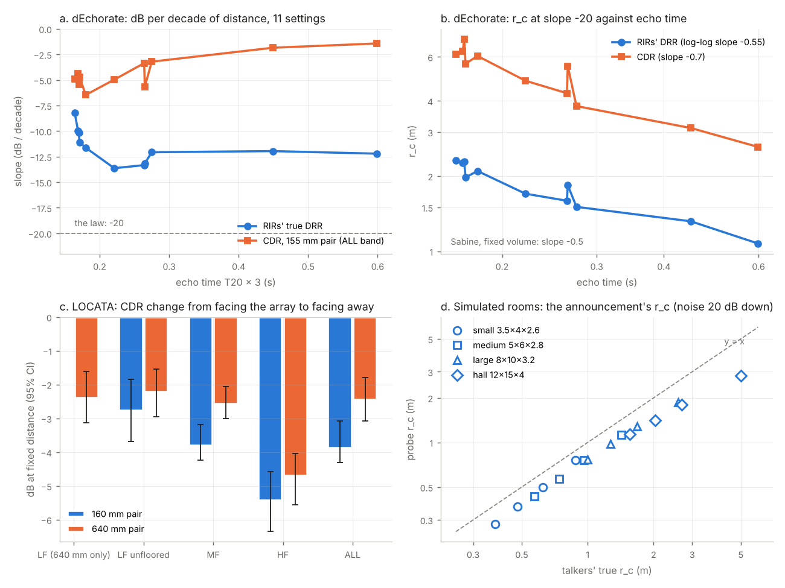

# Brief 20: range from the opener, turned heads, and the announcement as a room probe

**Reading it:**
- **Data:** the direction-free CDR (`src/geonar/cdr_direct.py`'s estimator, `harness/range_facing/drr.py`) per band
  stands in for the DRR. The data are dEchorate, STARSS23, LOCATA, and step 5's simulated rooms.
- **The bands:** LF 0.1-1 kHz, MF 1-4 kHz, HF 4-8 kHz, ALL 0.1-8 kHz.
  - **Floored and raw:** cdr_direct floors every band at c/2d, below which the diffuse field is coherent across the
    pair too. At the phone's 157 mm that's 1.1 kHz, so **the brief's LF band is empty on every phone-width pair**.
    Each band is therefore also read unfloored ("raw"), where the formula is ill-conditioned.
  - **The wide pair:** LOCATA adds DICIT mics 3-12 (640 mm, c/2d = 268 Hz) as the one pair with a real LF read.
- **Units:** range errors are in doublings (log2 of the ratio): 0.5 doublings is a factor of 1.41, 1 doubling is 2x.
- **Numbers:** `summary.json` (steps 1-4) and `sim_summary.json` (step 5). The protocol for Jay's own check is
  `protocol.md`. `range_facing.png` is the figure.

## The answers

1. **The law's −20 dB per decade doesn't hold for the CDR in any room, and only roughly for the true DRR.**
   - **dEchorate:** over 1-4 m, the RIRs' own DRR falls 8-14 dB per decade. The CDR follows only a quarter to
     three-fifths of that swing, so it falls 1.4-6.5 dB per decade.
   - **LOCATA** reads −6.5 to −7.8, and **the STARSS23 rooms that keep any slope** read −3 to −10.
   - **Nine of the 16 STARSS23 rooms fail outright:** their slope isn't 2 standard errors below zero, over distance
     spans as short as 1.0-1.85 m.
   - **r_c does follow the echo time across dEchorate's settings:** Spearman −0.95 from the RIRs and −0.93 from the
     CDR. On log-log axes it falls with slope −0.55 (RIRs) and −0.70 (CDR), against Sabine's −0.5.
2. **The opener anchors relative range only where distances actually change.** On LOCATA the law, read from the
   opener, beats "everyone is at the opener's distance": median error 0.41 against 0.45 doublings, 65% against 58%
   within 1.5x. The best band is the wide pair's LF: 0.37 doublings, 70% within 1.5x.
   - **Where it loses:** on STARSS23 (whose recordings barely change distance) and on dEchorate it loses to that
     baseline.
   - **Far reads:** they come out too near, by about two-thirds of a doubling, because the CDR's slope is a third of
     −20.
   - **Ordering and spread match batch A's CDR numbers**, as they must (the law is monotonic in the CDR).
3. **Facing away lowers HF most and LF least, as Jay said, but the phone pair's read-to-read jitter hides it.**
   - **The size, at fixed distance:** facing away costs HF 5.4 dB, ALL 3.9 dB and unfloored LF 2.8 dB (160 mm). On
     the wide pair the floored LF costs 2.4 dB.
   - **The flinging test:** reads within 0.3 m that differ by ≥60° in facing jump no more than reads that don't (0.25
     against 0.28 doublings, ALL). The exception is HF (0.47 against 0.29).
   - **Neither compensation earns its keep on the phone pair.** The HF − LF correction is fitted at nearly zero weight,
     and LF alone is worse there (0.48 doublings).
4. **Coarse facing from HF − LF fails on the first rung.** On the phone pair (160 mm), toward-versus-away reaches
   44.9% balanced accuracy against 50% chance (permutation p = 1.0). The wide pair fails too.
5. **The announcement does measure the room, with a steady bias.** In 16 simulated rooms (3.5x4 to 12x15 m, echo time
   0.25-0.9 s), the probe reads r_c about 24% low in every room. The cause is the reverberant field 3 cm from the speaker,
   which is about 2.5 dB hotter than across the room. The echo time comes out about 15% long, and neither moves with
   noise down to 0 dB. The weak link is the CDR, not the probe:
   - **The CDR against the probe's line:** it reads about 8 dB above it, at half its slope.
   - **Absolute range:** from the true DRR and the probe's r_c it is within 0.40 doublings (1.32x); from the CDR it is
     1.3 doublings too near.

## 1. The law, per room

The fit is CDR = a + b log10 r per band. The law says b = −20. r_c is the law's own fit, with b held at −20:
r_c = 10^(mean(CDR + 20 log10 r) / 20). The scatter is the residual standard deviation about the free fit. **F**
marks a band that fails outright: its free slope isn't 2 standard errors below 0, so there's no distance in it.

### dEchorate: one room, 11 wall settings

The 155 mm pair, mics 0 and 3 of each of the 6 arrays, the 6 sources, and 24 EARS onsets each: 864 cuts per setting,
1.0-4.1 m. The RIR columns are the dataset's own impulse responses, read the same way (direct ±1 ms against the rest).
"CDR / RIR swing" is the slope of the CDR on the RIRs' DRR, which says how much of the true swing the CDR follows.

| setting | T60 (s) | RIR DRR slope | RIR r_c (m) | CDR slope ALL | scatter | CDR r_c (m) | MF slope | HF slope | LF raw slope | CDR / RIR swing |
|---|---|---|---|---|---|---|---|---|---|---|
| 000100 | 0.16 | -8.2 | 2.30 | -4.9 | 2.9 | 6.13 | -5.1 | 1.2 **F** | -5.5 | 0.62 |
| 000010 | 0.17 | -10.0 | 2.25 | -4.4 | 2.9 | 6.32 | -4.4 | -1.3 **F** | -4.7 | 0.52 |
| 000000 | 0.17 | -10.1 | 2.28 | -5.4 | 3.0 | 7.07 | -5.6 | -0.1 **F** | -4.7 | 0.61 |
| 001000 | 0.17 | -11.1 | 1.98 | -4.7 | 2.6 | 5.63 | -4.9 | 0.8 **F** | -6.9 | 0.47 |
| 000001 | 0.18 | -11.6 | 2.10 | -6.5 | 3.0 | 6.05 | -6.7 | -0.4 **F** | -5.0 | 0.59 |
| 020002 | 0.22 | -13.6 | 1.70 | -5.0 | 2.9 | 4.82 | -5.0 | -1.7 | -4.8 | 0.52 |
| 011000 | 0.26 | -13.3 | 1.59 | -3.4 | 2.3 | 4.29 | -3.4 | -0.2 **F** | -5.2 | 0.34 |
| 010000 | 0.27 | -13.2 | 1.84 | -5.7 | 3.1 | 5.51 | -5.8 | -1.3 **F** | -6.2 | 0.57 |
| 011100 | 0.28 | -12.1 | 1.51 | -3.2 | 2.2 | 3.81 | -3.3 | -0.1 **F** | -4.2 | 0.32 |
| 011110 | 0.45 | -12.0 | 1.32 | -1.9 | 1.9 | 3.11 | -1.8 | -1.2 | -4.5 | 0.30 |
| 011111 | 0.60 | -12.2 | 1.07 | -1.4 | 1.9 | 2.62 | -1.4 | -1.3 | -3.9 | 0.25 |

- **Even the truth isn't at −20.** Over 1-4 m in this room, the RIRs' own DRR falls 8-14 dB per decade. Early
  reflections from the panels sit inside the "reverberant" side and fall with distance too.
- **The CDR follows a quarter to three-fifths of the true swing,** and less the more reverberant the room.
  - **In the most reverberant setting,** 011111 (T60 0.6 s), the CDR falls only 1.4 dB per decade against the RIRs'
    12.2.
  - **The simulation shows why** (section 5): the CDR keeps the law's slope inside r_c and flattens beyond it. Here
    most talkers are beyond it.
- **r_c follows the echo time.**
  - Spearman −0.95 (RIRs) and −0.93 (CDR) across the 11 settings.
  - On log-log axes the fall is −0.55 (RIRs) and −0.70 (CDR). Sabine's r_c ∝ sqrt(V / T60) gives −0.5 at fixed
    volume.
  - The CDR's r_c sits 2.4-3.1 times the RIRs': the CDR reads high, as it does in simulation.
- **HF fails in 8 of 11 settings.** The RIRs' own HF DRR is nearly flat too (−1.6 to −8.3). dEchorate's loudspeakers
  aim in fixed directions (two face a wall), and at HF their directivity, not their distance, sets the direct sound.
  That is the turned head in loudspeaker form.

### LOCATA: one room, three pairs

341 talker onsets per pair, tasks 3 and 4, dev and eval sets, 0.5-3.2 m. The 160 and 80 mm pairs have no floored LF.

| pair | n | distance (m) | LF slope | LF raw | MF | HF | ALL | ALL scatter (dB) | ALL r_c (m) |
|---|---|---|---|---|---|---|---|---|---|
| 160mm | 341 | 0.52-3.17 | empty | -6.1 ± 0.8 | -8.0 ± 0.8 | -6.8 ± 1.0 | -7.8 ± 0.8 | 2.3 | 2.37 |
| 640mm | 341 | 0.52-3.17 | -6.7 ± 0.7 | -6.9 ± 0.7 | -4.7 ± 0.6 | -4.4 ± 0.8 | -6.5 ± 0.6 | 1.8 | 2.06 |
| 80mm | 341 | 0.52-3.17 | empty | -7.0 ± 0.7 | -8.3 ± 0.9 | -6.3 ± 1.0 | -7.8 ± 0.9 | 2.5 | 2.32 |

All three pairs hold a clean slope, about a third of the law's.

### STARSS23: 16 rooms

The solo speech onsets only, pairs 1-2 and 3-4 (68.5 mm) pooled. No facing truth. Floored LF is empty at 68.5 mm
(c/2d = 2.5 kHz).

| room | solo onsets | distance (m) | ALL slope | ALL scatter | ALL r_c (m) | MF slope | HF slope | LF raw slope |
|---|---|---|---|---|---|---|---|---|
| room2 | 174 | 1.02-1.85 | -0.4 ± 1.3 **F** | 1.2 | 1.42 | 0.8 ± 1.4 **F** | -2.2 ± 1.7 **F** | -0.3 ± 2.8 **F** |
| room4 | 160 | 0.69-2.4 | -3.0 ± 0.9 | 1.7 | 1.67 | -2.3 ± 0.9 | -2.9 ± 1.0 | -6.5 ± 1.1 |
| room6 | 218 | 0.47-2.54 | -0.4 ± 1.2 **F** | 2.0 | 2.08 | -0.7 ± 1.2 **F** | -2.7 ± 1.4 **F** | -3.6 ± 1.8 **F** |
| room7 | 116 | 1.56-2.96 | -2.0 ± 2.9 **F** | 1.8 | 2.69 | -2.1 ± 3.0 **F** | -8.6 ± 4.0 | -12.0 ± 4.3 |
| room8 | 168 | 1.17-2.13 | 13.2 ± 2.2 **F** | 2.1 | 1.70 | 12.2 ± 2.2 **F** | 12.8 ± 2.7 **F** | 8.5 ± 3.2 **F** |
| room9 | 332 | 1.43-2.63 | -9.9 ± 2.8 | 3.1 | 2.63 | -9.9 ± 2.8 | -9.1 ± 2.6 | -7.9 ± 2.8 |
| room10 | 110 | 1.08-2.24 | 6.0 ± 3.1 **F** | 2.2 | 1.65 | 5.7 ± 3.1 **F** | 4.2 ± 3.2 **F** | -3.5 ± 3.2 **F** |
| room12 | 312 | 0.74-2.24 | -3.4 ± 1.5 | 2.0 | 1.67 | -2.9 ± 1.6 **F** | -7.8 ± 1.9 | -5.2 ± 1.9 |
| room13 | 402 | 0.95-2.82 | -3.0 ± 0.8 | 2.4 | 2.13 | -2.7 ± 0.7 | -3.1 ± 1.0 | -1.2 ± 0.9 **F** |
| room14 | 58 | 0.97-3.69 | -6.4 ± 1.6 | 1.5 | 2.17 | -5.8 ± 1.7 | -7.8 ± 1.7 | 1.2 ± 2.7 **F** |
| room15 | 104 | 0.93-2.08 | -4.4 ± 2.9 **F** | 2.2 | 1.74 | -5.3 ± 3.0 **F** | -4.1 ± 3.8 **F** | -8.8 ± 3.0 |
| room16 | 248 | 1.03-3.28 | -5.7 ± 1.2 | 2.2 | 2.60 | -6.1 ± 1.3 | -4.3 ± 1.6 | -1.2 ± 1.8 **F** |
| room21 | 218 | 0.89-3.7 | -5.2 ± 0.8 | 2.1 | 1.82 | -4.6 ± 0.9 | -4.7 ± 0.9 | -8.7 ± 1.0 |
| room22 | 132 | 0.64-3.68 | 0.2 ± 1.4 **F** | 1.9 | 1.44 | -0.4 ± 1.3 **F** | -1.3 ± 1.5 **F** | 0.3 ± 2.0 **F** |
| room23 | 44 | 0.72-3.47 | 0.6 ± 1.5 **F** | 1.6 | 2.15 | 0.6 ± 1.6 **F** | -1.3 ± 1.6 **F** | -1.8 ± 2.3 **F** |
| room24 | 58 | 1.26-2.05 | 6.3 ± 3.4 **F** | 1.8 | 1.39 | 7.3 ± 3.5 **F** | 1.0 ± 3.8 **F** | 1.9 ± 3.9 **F** |

- **Seven rooms keep a slope on ALL:** room4, 9, 12, 13, 14, 16 and 21, at −3.0 to −9.9 dB per decade.
- **Nine fail outright and are set aside:** room2, 6, 7, 8, 10, 15, 22, 23 and 24.
  - **Short distance spans:** four of them span less than 2x in distance (room2 1.0-1.85 m, room7 1.6-3.0, room8
    1.2-2.1, room24 1.3-2.1), and room10 and room15 barely more. That's under 2 dB of law to find, in 2 dB of scatter.
  - **Wrong slopes:** room8, 10 and 24 slope the wrong way (+6 to +13). Their cause isn't found here.
  - **Flat over wide spans:** room6, 22 and 23 span 4.8-5.7x and still read flat. These are worth a look in their own
    right.
- **How much r_c varies:** at −20 it runs 1.4-2.7 m across the 16 rooms. On dEchorate it runs 2.6-7.1 m from the
  CDR and 1.1-2.3 m from the RIRs. A factor of about 2 either way.
  - **It doesn't measure the room:** with the CDR's slope this shallow, r_c at −20 mostly measures the CDR's mean.

## 2. Anchor on the opener

**The opener** is the first onset of a talker alone, per recording:
- **LOCATA:** no other talker voice-active within 0.5 s, and facing the array within 30°.
- **STARSS23:** the first solo speech onset (STARSS23 has no facing truth, so facing isn't checked).
- **dEchorate:** has no timeline, so every cut serves as the opener in turn for the other cuts of its setting and
  array (the phone stays put; the talker moves over the 6 sources).

**The prediction:** every later read's ratio is 10^((CDR_opener − CDR)/20).

**The error:** log2(predicted / true ratio), in doublings. A recording whose median error is over a doubling fails
outright; it is set aside, and its count is in the last column. Beside the law:
- **The baseline:** no information at all, every later read at the opener's distance.
- **The own-slope diagnostic:** the CDR's own slope, fitted on the other recordings, in place of −20. A diagnostic,
  not a new equation.

**The ordering columns** are batch A's same-talker pair score. The law is monotonic in the CDR, so they are the CDR's
own ordering on the reads kept.

| band | dataset | reads | law: median error | law: within 1.5x | baseline (ratio 1): median | baseline within 1.5x | reads ≥2x from opener: law error | own slope (diagnostic) | ordering 1.25x / 1.5x / 2x | spread, step (dB) | recordings set aside |
|---|---|---|---|---|---|---|---|---|---|---|---|
| ALL | starss23 | 8188 | 0.37 | 70% | 0.15 | 84% | 0.72 | 3.44 | 61.2 / 64.4 / 70.7 | 1.49, 1.55 | 9 |
| ALL | locata | 614 | 0.41 | 65% | 0.45 | 58% | 0.63 | 0.94 | 66.2 / 70.6 / 85.3 | 1.59, 4.09 | 1 |
| ALL | dechorate | 1359072 | 0.53 | 54% | 0.47 | 54% | 1.11 | 1.65 | 59.7 / 61.3 / 61.9 | 1.36, 2.77 | 0 |
| MF | starss23 | 8173 | 0.38 | 68% | 0.15 | 84% | 0.79 | 3.37 | 60.2 / 63.3 / 68.7 | 1.57, 1.70 | 10 |
| MF | locata | 614 | 0.43 | 64% | 0.45 | 58% | 0.62 | 1.03 | 64.9 / 69.0 / 82.6 | 1.58, 3.72 | 1 |
| MF | dechorate | 1359072 | 0.54 | 53% | 0.47 | 54% | 1.11 | 1.65 | 59.7 / 61.3 / 62.0 | 1.39, 2.81 | 0 |
| HF | starss23 | 7914 | 0.38 | 68% | 0.15 | 85% | 0.62 | 4.24 | 61.8 / 65.4 / 71.7 | 1.73, 1.28 | 16 |
| HF | locata | 605 | 0.50 | 59% | 0.45 | 58% | 0.90 | 1.73 | 60.3 / 64.3 / 76.3 | 2.00, 3.86 | 3 |
| HF | dechorate | 1214928 | 0.76 | 40% | 0.46 | 54% | 1.20 | 4.81 | 55.9 / 55.6 / 55.1 | 3.17, 3.93 | 7 |
| LF_raw | starss23 | 7701 | 0.47 | 60% | 0.18 | 83% | 0.94 | 3.48 | 57.0 / 64.8 / 63.7 | 2.12, 2.42 | 16 |
| LF_raw | locata | 621 | 0.41 | 66% | 0.45 | 58% | 0.73 | 0.84 | 71.9 / 76.8 / 87.8 | 1.56, 4.05 | 0 |
| LF_raw | dechorate | 1359072 | 0.51 | 56% | 0.47 | 54% | 0.88 | 1.33 | 67.0 / 68.4 / 72.7 | 1.72, 3.42 | 0 |
| ALL_raw | starss23 | 7963 | 0.46 | 61% | 0.16 | 83% | 0.97 | 3.38 | 57.9 / 65.4 / 65.1 | 2.01, 2.20 | 10 |
| ALL_raw | locata | 621 | 0.41 | 68% | 0.45 | 58% | 0.68 | 0.82 | 72.4 / 77.6 / 89.4 | 1.49, 3.92 | 0 |
| ALL_raw | dechorate | 1359072 | 0.49 | 58% | 0.47 | 54% | 0.91 | 1.27 | 67.3 / 68.8 / 72.7 | 1.56, 3.13 | 0 |
| LF | locata | 207 | 0.37 | 70% | 0.45 | 58% | 0.67 | 0.83 | 68.7 / 73.8 / 88.1 | 1.51, 4.21 | 0 |

LOCATA by pair:

| pair | band | reads | median error | within 1.5x | ≥2x from opener | ordering 2x | spread, step (dB) |
|---|---|---|---|---|---|---|---|
| 160 | LF_raw | 207 | 0.48 | 62% | 0.66 | 83.8 | 1.69, 4.11 |
| 160 | MF | 207 | 0.39 | 69% | 0.49 | 88.1 | 1.85, 4.54 |
| 160 | HF | 202 | 0.47 | 60% | 0.86 | 80.4 | 1.98, 4.51 |
| 160 | ALL | 207 | 0.39 | 69% | 0.51 | 89.2 | 1.81, 4.57 |
| 160 | ALL_raw | 207 | 0.44 | 65% | 0.61 | 88.1 | 1.59, 4.01 |
| 80 | LF_raw | 207 | 0.41 | 64% | 0.77 | 89.2 | 1.62, 3.69 |
| 80 | MF | 200 | 0.55 | 53% | 0.69 | 76.4 | 1.53, 4.01 |
| 80 | HF | 196 | 0.48 | 63% | 0.59 | 74.1 | 2.00, 4.18 |
| 80 | ALL | 200 | 0.54 | 54% | 0.66 | 77.6 | 1.44, 3.66 |
| 80 | ALL_raw | 207 | 0.40 | 66% | 0.76 | 89.6 | 1.60, 3.80 |
| 640 | LF | 207 | 0.37 | 70% | 0.67 | 88.1 | 1.51, 4.21 |
| 640 | LF_raw | 207 | 0.37 | 70% | 0.73 | 90.4 | 1.40, 4.08 |
| 640 | MF | 207 | 0.36 | 70% | 0.53 | 83.1 | 1.48, 2.92 |
| 640 | HF | 207 | 0.56 | 53% | 1.04 | 74.2 | 2.03, 3.19 |
| 640 | ALL | 207 | 0.36 | 73% | 0.65 | 88.8 | 1.40, 3.96 |
| 640 | ALL_raw | 207 | 0.38 | 72% | 0.67 | 90.4 | 1.33, 3.96 |

- **On LOCATA, the law beats the baseline.** The best is the wide pair's LF: 0.37 doublings and 70% within 1.5x,
  against the baseline's 0.45 and 58%. On the phone pair, ALL gets 0.39 and 69%.
- **On STARSS23 it loses to the baseline:** 0.37 against 0.15. In a STARSS23 recording the talkers barely move: only
  16% of later reads are more than 1.5x from the opener's distance. A predictor with 2 dB of noise does worse than
  "no change".
- **On dEchorate it about ties** (0.53 against 0.47 doublings; 54% within 1.5x for both).
- **The law under-reads big changes.** Reads at least 2x from the opener are under-predicted by 0.5-1.1 doublings, because the CDR falls a third as fast as −20.
- **The CDR's own slope is worse everywhere** (0.8-4.8 doublings). Dividing 2-3 dB of scatter by a 3-8 dB/decade slope
  makes a factor of 2-6 in range. The law's −20 shrinks the noise as it shrinks the signal. That is a reason to keep
  −20 as a conservative mapping, not evidence that the law holds.
- **Against batch A's CDR numbers:**

  | dataset | batch A: ordering 1.25x / 1.5x / 2x | batch A: spread, step (dB) | here (ALL) | here: spread, step (dB) |
  |---|---|---|---|---|
  | STARSS23 | 63.5 / 66.4 / 71.6 | 1.4, 1.4 | 61.2 / 64.4 / 70.7 | 1.49, 1.55 |
  | LOCATA | 67.1 / 72.3 / 85.2 | 1.1, 3.2 | 66.2 / 70.6 / 85.3 | 1.59, 4.09 |

  The same within a point or two. Here the reads are those after the opener, with failed recordings out, and LOCATA
  adds the 640 mm pair.
- **Outliers** (error over 2x, ALL band):
  - **STARSS23:** 749. Another labelled source was active in 449 of them (60%), and the talker was nearer than 1 m in
    45. The other 255 have no labelled cause.
  - **LOCATA:** 66. Another talker was active in 46, the talker faced away in 13, and 7 have no labelled cause.
  - **The other talker is the outlier maker,** as it was for the angle in batch A.

## 3. Turned heads (LOCATA)

**The facing coefficient:** CDR = a + b log10 r + c (facing / 180°), on the unsigned facing truth, bootstrapped over
the 13 recordings. c is the change from facing the array to facing away, at a fixed distance.

**The flinging columns** are pairs of one talker's reads with heads within 0.3 m. The median jump in predicted range
(doublings, at the law's −20) is shown when the facing differs by at least 60° (55 pairs), and when it differs by at
most 20° (184 pairs).

| pair | band | dB per decade | facing away (dB) | 95% CI | flinging: turned ≥60° | still ≤20° |
|---|---|---|---|---|---|---|
| 160mm | LF_raw | -5.9 | -2.8 | -3.7 to -1.9 | 0.31 | 0.27 |
| 160mm | MF | -7.8 | -3.8 | -4.2 to -3.2 | 0.24 | 0.30 |
| 160mm | HF | -6.5 | -5.4 | -6.3 to -4.6 | 0.47 | 0.29 |
| 160mm | ALL | -7.6 | -3.9 | -4.3 to -3.1 | 0.25 | 0.28 |
| 160mm | ALL_raw | -6.1 | -2.8 | -3.9 to -1.9 | 0.28 | 0.25 |
| 160mm | HF − LF | -0.6 | -2.7 | -3.8 to -1.4 | – | – |
| 80mm | LF_raw | -6.8 | -2.3 | -2.8 to -1.9 | 0.29 | 0.25 |
| 80mm | MF | -8.0 | -4.9 | -6.1 to -3.8 | 0.35 | 0.21 |
| 80mm | HF | -6.0 | -6.0 | -6.9 to -4.8 | 0.43 | 0.28 |
| 80mm | ALL | -7.5 | -5.1 | -6.3 to -4.1 | 0.34 | 0.21 |
| 80mm | ALL_raw | -6.9 | -2.4 | -2.8 to -1.9 | 0.28 | 0.24 |
| 80mm | HF − LF | 0.8 | -3.7 | -4.6 to -2.5 | – | – |
| 640mm | LF | -6.6 | -2.4 | -3.1 to -1.6 | 0.21 | 0.23 |
| 640mm | LF_raw | -6.8 | -2.2 | -3.0 to -1.6 | 0.22 | 0.21 |
| 640mm | MF | -4.5 | -2.6 | -3.0 to -2.1 | 0.26 | 0.25 |
| 640mm | HF | -4.1 | -4.7 | -5.6 to -4.0 | 0.47 | 0.29 |
| 640mm | ALL | -6.3 | -2.5 | -3.1 to -1.8 | 0.21 | 0.24 |
| 640mm | ALL_raw | -6.6 | -2.2 | -3.0 to -1.6 | 0.23 | 0.22 |
| 640mm | HF − LF | 2.5 | -2.3 | -3.1 to -1.3 | – | – |

- **LF moves least, on every pair, as Jay said.** Facing away costs HF 5.4 dB, MF 3.8 dB and unfloored LF 2.8 dB (160
  mm). On the wide pair, the properly floored LF costs 2.4 dB against HF's 4.7 dB. LF doesn't stand still, though: a
  turned head loses some of its LF direct sound too.
- **On the CDR's own distance scale, a turned head is big.** ALL's 3.9 dB is half a decade of CDR slope (−7.6 dB per
  decade), so facing away "looks" about 3x farther. The law's −20 maps it to 1.57x.
- **But the flinging test doesn't see it in pairs.**
  - **ALL and LF:** reads within 0.3 m that differ by 60° or more jump no further than still pairs (0.25 against 0.28
    doublings, ALL, 160 mm).
  - **Why:** by the coefficient, a 60-120° turn is worth 1.3-2.6 dB, and the read-to-read jitter is about 1.7 dB.
  - **HF is the exception:** 0.47 against 0.29 doublings, a 1.38x jump.
- **The compensations,** scored as step 2:

| pair | range from | median error | within 1.5x | ≥2x from opener | ordering 1.25x / 1.5x / 2x | spread, step (dB) | fling: turned / still |
|---|---|---|---|---|---|---|---|
| 160mm | ALL | 0.39 | 69% | 0.51 | 67.2 / 72.8 / 89.2 | 1.81, 4.57 | 0.25 / 0.28 |
| 160mm | LF alone | 0.48 | 62% | 0.66 | 69.2 / 73.5 / 83.8 | 1.69, 4.11 | 0.31 / 0.27 |
| 160mm | ALL corrected by HF-LF (k = 0.07) | 0.37 | 70% | 0.48 | 68.9 / 74.8 / 90.2 | 1.82, 4.58 | 0.22 / 0.29 |
| 80mm | ALL | 0.54 | 54% | 0.66 | 62.2 / 64.8 / 77.6 | 1.44, 3.66 | 0.34 / 0.21 |
| 80mm | LF alone | 0.41 | 64% | 0.77 | 73.3 / 79.0 / 89.2 | 1.62, 3.69 | 0.29 / 0.25 |
| 80mm | ALL corrected by HF-LF (k = 0.21) | 0.47 | 63% | 0.72 | 64.7 / 68.7 / 79.6 | 1.44, 3.98 | 0.28 / 0.22 |
| 640mm | ALL | 0.36 | 73% | 0.65 | 69.2 / 74.0 / 88.8 | 1.40, 3.96 | 0.21 / 0.24 |
| 640mm | LF alone | 0.37 | 70% | 0.67 | 68.7 / 73.8 / 88.1 | 1.51, 4.21 | 0.21 / 0.23 |
| 640mm | ALL corrected by HF-LF (k = -0.20) | 0.36 | 70% | 0.69 | 70.7 / 76.7 / 90.6 | 1.43, 3.67 | 0.28 / 0.22 |

- **Neither compensation earns its keep on the phone pair.**
  - **The HF − LF correction:** fitted on the other recordings, it takes k = 0.07 of HF − LF, almost nothing. Its own
    noise (about 3 dB) is as big as the facing effect it would remove (2.7 dB). It changes the error by 0.02 doublings.
  - **LF alone:** on 160 mm it can only be read unfloored, and it is worse there (0.48 doublings against ALL's 0.39).
  - **The two exceptions:**
    - At 80 mm, unfloored LF beats floored ALL, but only because floored ALL starts at c/2d = 2.1 kHz there, so it has
      no LF in it.
    - On the wide pair, LF alone ties ALL.

## 4. Coarse facing, as a ladder (LOCATA)

The feature is HF − LF minus the opener's, with log10 distance as a covariate. The classifier is a logistic
regression, left out by recording. **The rungs** are on the unsigned facing:
1. Toward or away (90°).
2. Front, side or back (45° and 135°). These are the quadrants with the two sides merged: LOCATA's facing truth is
   unsigned, and a level difference between two bands can't tell a left turn from a right one either.
3. 45° steps.

**Chance** is given both as the majority class and as 1/k. **The permutation p** shuffles labels within each
recording (100 permutations). A rung fails at p ≥ 0.05, and the ladder stops there.

| pair | rung | reads (per class) | accuracy | balanced | chance: majority / uniform | permutation p | |
|---|---|---|---|---|---|---|---|
| 160mm | toward / away (90 deg) | 249 (161 / 88) | 57.0% | 44.9% | 64.7% / 50.0% | 1.00 | fails: stop |
| 640mm | toward / away (90 deg) | 249 (161 / 88) | 59.0% | 47.5% | 64.7% / 50.0% | 0.99 | fails: stop |
| 80mm | toward / away (90 deg) | 249 (161 / 88) | 61.8% | 54.3% | 64.7% / 50.0% | 0.01 | passes |
| 80mm | front / side / back (45, 135 deg) | 249 (83 / 136 / 30) | 54.2% | 36.0% | 54.6% / 33.3% | 0.04 | passes |
| 80mm | 45 deg steps | 249 (83 / 78 / 58 / 30) | 34.9% | 29.4% | 33.3% / 25.0% | 0.04 | passes |

**Stop at rung 1 on the phone pair and on the wide pair:** toward against away doesn't beat chance.
- **The 80 mm pair** passes all three rungs at p ≤ 0.04, but barely. Its balanced accuracy is 4-5 points over 1/k,
  and its accuracy is under the majority share on every rung. A real but tiny cue: three tests at p 0.01-0.04 are
  what one would expect if it were just over noise.
- **HF − LF does move with facing** (−2.3 to −3.7 dB). It just doesn't move far enough above its own 3 dB scatter.

## 5. The phone's announcement as a room probe (simulated)

**The method,** `sim_probe.py`:
- **The rooms:** 16 pyroomacoustics shoeboxes, 4 sizes (3.5x4x2.6 to 12x15x4 m) × 4 echo times (0.25-0.9 s, Sabine
  absorption, image sources), flat absorption.
- **The phone:** a 157 mm pair on a 0.8 m "table" (no table in the model). The speaker is a point 3 cm past the
  lower mic.
- **The talkers:** up to 14 positions at 0.5-4 m, at random bearings and 1.5 m high, with 4 EARS onsets each.
- **The noise:** white, independent per mic, at 7 levels, from 50 dB under the talker's direct level at 1 m to 20 dB
  over it.
- **The announcement:** 10 dB over the talker at 1 m.

**The read:**
- **The calibration:** outdoors (free field) gives the phone's own direct path per mic, as a 3.3 ms least-squares FIR,
  and the level at 1 m on axis.
- **The tail:** in the room, the direct path's prediction is subtracted, and what's left in 0.5-4 kHz, less the
  noise's share, is the reverberant level. Then r_c = 1 m × sqrt(G_1m / G_reverb).
- **The echo time:** fitted on the fall after the last word, as the dry signal's envelope smeared by an exponential.
- **Dropped first:** a regularised deconvolution of the announcement. Its leakage sits about 40 dB under the 3 cm
  direct sound, which is where the room's tail is.

**The truth:**
- r_c from the talkers' own true DRRs, at slope −20.
- The echo time from the talkers' RIRs (Schroeder, T20 × 3).

Per room at noise 20 dB under the talker (ALL band for the talkers):

| room | echo time: nominal / true (s) | r_c true (m) | Sabine | probe | probe error | echo time probe (s) | error | true DRR slope | CDR (ALL) slope | CDR over the probe line (dB) | range error: probe r_c / true r_c (doublings) |
|---|---|---|---|---|---|---|---|---|---|---|---|
| small 3.5x4x2.6 | 0.25 / 0.23 | 0.88 | 0.68 | 0.76 | -14% | 0.25 | +12% | -19.0 | -9.0 | +7.7 | -1.27 / -1.05 |
| small 3.5x4x2.6 | 0.4 / 0.39 | 0.62 | 0.54 | 0.50 | -20% | 0.43 | +11% | -18.6 | -5.9 | +8.2 | -1.36 / -1.04 |
| small 3.5x4x2.6 | 0.6 / 0.61 | 0.48 | 0.44 | 0.37 | -22% | 0.66 | +7% | -18.6 | -5.1 | +8.8 | -1.47 / -1.10 |
| small 3.5x4x2.6 | 0.9 / 0.94 | 0.38 | 0.36 | 0.28 | -25% | 1.04 | +11% | -18.2 | -5.8 | +10.9 | -1.81 / -1.39 |
| medium 5x6x2.8 | 0.25 / 0.22 | 1.43 | 1.04 | 1.13 | -21% | 0.21 | -3% | -18.3 | -8.6 | +6.9 | -1.15 / -0.81 |
| medium 5x6x2.8 | 0.4 / 0.41 | 0.96 | 0.82 | 0.76 | -21% | 0.48 | +18% | -18.8 | -7.5 | +7.5 | -1.24 / -0.90 |
| medium 5x6x2.8 | 0.6 / 0.65 | 0.74 | 0.67 | 0.57 | -23% | 0.76 | +16% | -18.7 | -3.1 | +8.7 | -1.45 / -1.07 |
| medium 5x6x2.8 | 0.9 / 1.02 | 0.57 | 0.55 | 0.43 | -24% | 0.94 | -7% | -18.6 | -5.8 | +9.1 | -1.52 / -1.12 |
| large 8x10x3.2 | 0.25 / 0.20 | 2.58 | 1.81 | 1.87 | -27% | 0.26 | +28% | -17.8 | -13.5 | +8.6 | -1.43 / -0.97 |
| large 8x10x3.2 | 0.4 / 0.41 | 1.68 | 1.43 | 1.28 | -24% | 0.48 | +17% | -18.4 | -13.3 | +7.1 | -1.19 / -0.80 |
| large 8x10x3.2 | 0.6 / 0.69 | 1.27 | 1.17 | 0.98 | -23% | 0.76 | +10% | -18.6 | -10.7 | +6.6 | -1.09 / -0.72 |
| large 8x10x3.2 | 0.9 / 1.13 | 1.00 | 0.95 | 0.77 | -23% | 1.23 | +9% | -18.6 | -11.0 | +6.5 | -1.07 / -0.69 |
| hall 12x15x4 | 0.25 / 0.13 | 5.01 | 3.04 | 2.81 | -44% | 0.24 | +87% | -15.6 | -18.0 | +11.6 | -1.92 / -1.09 |
| hall 12x15x4 | 0.4 / 0.35 | 2.69 | 2.40 | 1.81 | -33% | 0.46 | +30% | -16.8 | -18.7 | +9.4 | -1.56 / -0.98 |
| hall 12x15x4 | 0.6 / 0.64 | 2.03 | 1.96 | 1.41 | -30% | 0.76 | +20% | -17.1 | -17.9 | +8.2 | -1.36 / -0.84 |
| hall 12x15x4 | 0.9 / 1.09 | 1.56 | 1.60 | 1.14 | -27% | 1.47 | +35% | -18.2 | -15.5 | +7.0 | -1.17 / -0.72 |

The noise column, over all 16 rooms:

| noise (dB under the talker at 1 m) | r_c error: median | echo time error: median | echo time: no fit |
|---|---|---|---|
| 50 | -23.5% | +14.2% | 0 of 16 |
| 35 | -23.5% | +14.2% | 0 of 16 |
| 20 | -23.5% | +14.2% | 0 of 16 |
| 10 | -23.5% | +15.2% | 0 of 16 |
| 0 | -23.5% | +13.7% | 0 of 16 |
| -10 | -23.5% | +20.3% | 1 of 16 |
| -20 | -23.9% | +42.7% | 4 of 16 |

The talkers' CDR per band against the probe's line, the median over rooms at noise ≥ 20 dB down:

| band | CDR slope (dB/decade) | CDR over the probe line (dB) | range error with probe r_c | with true r_c |
|---|---|---|---|---|
| LF_raw | -10.9 | +9.5 | -1.58 | -1.17 |
| MF | -9.8 | +8.1 | -1.35 | -0.96 |
| HF | -11.3 | +8.1 | -1.34 | -0.91 |
| ALL | -9.8 | +8.1 | -1.34 | -0.96 |
| ALL_raw | -10.5 | +9.2 | -1.53 | -1.11 |

- **The probe reads r_c low by a steady 24% (14-44%),** whatever the echo time and the noise.
  - **The cause is physical.** The reverberant field within a few cm of a source is 2-3.5 dB hotter than across the
    room. A direct check in the same models: the non-direct energy 3 cm from the source against 2 m is +3.5 dB in
    the hall and +2.2-2.3 dB in the smaller rooms. The diffuse-field formula assumes the level is the same everywhere.
  - **The correction:** a fixed ×1.31 would put 13 of 16 rooms within ±12%, but that factor was fitted on these same
    rooms.
  - **The worst room is the dry hall** (r_c 5 m, T60 0.13 s): −44%. There the "tail" is mostly a few early
    reflections, not a diffuse field.
  - **Whether the bias carries over to real rooms is the protocol's question.**
- **The echo time comes out 14% long (−7% to +87%).** It is worst in the dry hall and in short echo times, where the
  decay is curved and short.
  - **Noise:** neither r_c nor the echo time moves with noise down to 0 dB (noise as loud as the talker at 1 m). The
    echo time degrades from −10 dB and gives no fit in 4 of 16 rooms at −20 dB. r_c holds even there, but only
    because the simulated noise is white and steady, so subtracting it is exact. Real noise won't be that kind.
- **The physics holds in simulation:** the talkers' true DRR falls −18.5 dB per decade (median), close to −20.
  Sabine's r_c is 10% under the true one.
- **The CDR doesn't follow the line.** It reads about 8 dB above the probe's predicted DRR, at about half the slope
  (−10 against −18.5).
  - **The CDR keeps the law's slope only inside r_c.** In the hall (r_c 1.6-5 m) the CDR falls −15.5 to −18.7 dB per
    decade. In the small live rooms (r_c 0.4-0.9 m) it falls −5 to −9. Beyond r_c it flattens.
  - **Absolute range from the CDR** comes out 1.3 doublings too near with the probe's r_c, and 0.96 too near even
    with the true r_c. From the true DRR with the probe's r_c it is within 0.40 doublings (1.32x).
  - **So the probe and the law would give rough metres. The CDR estimator is what stands in the way:** its +8 dB
    offset and its flattening beyond r_c.

### Real rooms: no co-located measured set reached in this session

No measured-RIR set with source-receiver distances under 0.3 m could be fetched here, so the co-located case isn't
tested on real rooms.
- **The closest match known here:** the Aachen Impulse Response (AIR) database's mock-up phone set. Its RIRs run from
  an artificial head's mouth to a phone mock-up held at the ear and in a hands-free position, a few cm apart, in
  several rooms.
  - **Not fetched:** its host (iks.rwth-aachen.de) is refused by this network policy, and its licence wasn't checked.
- **Zenodo searched:** the RIR sets listed there all keep the source at least ~0.5-1 m from the receivers.
  - Checked: 6DRIR-DL (8038733), the 3D meshgrid set (19656813), FLAIR (17037517), trajectoRIR (15564430), and the
    baffled-array set (11199830).
  - **dEchorate's nearest source** is 1.0 m from any pair.
- **What would test it:** AIR's phone set (once its host is allowed), or Jay's own recordings (`protocol.md`).

### The protocol

`protocol.md`: the one-time outdoor calibration (on the same book, with a 1 m reference mic, on axis and at four
angles for Q), then per room the opener, three announcements with 3 s of quiet after each, and the walk:
- **The walk:** 0.5-4 m facing the phone, then turned at 1 m and 2 m.
- **The checklist:** what each recording must contain.
- **The question it answers:** whether the −25% near-source bias and the +8 dB CDR offset carry over to real rooms.

## What was run, and what wasn't

- **The estimator:** `drr.py` is `cdr_direct.cdr_free_bands` with the brief's bands, plus unfloored reads. It
  reproduces cdr_free_bands exactly on the floored bands (checked on dEchorate cuts). `src/` is unchanged.
- **The cuts are the existing cutters' own:**
  - **dEchorate:** `harness/dechorate/dechorate_cut.py`, 155 mm, 24 onsets. Its white noise is 30 dB under the speech.
  - **STARSS23:** `harness/batchA/starss23/cut_all.py`, every speech onset, pairs 1-2 and 3-4. Step 1 uses only the
    solo onsets.
  - **LOCATA:** `harness/batchA/locata/locata_cut.py`, plus `locata_wide.py` for the 640 mm pair. LOCATA eval's facing
    truth is in the release, so dev and eval are both used.
- **STARSS23 pairs:** only two of the six pairs were read, and the two give near-identical rooms.
- **Step 4's balanced accuracy** is over the classes present. The permutation test keeps each recording's class mix.
- **Disk:** the cut audio was deleted once its CDR was read. Nothing with audio is committed.
- **The reads:** every read's CDR per band, with its truth and no audio, is in `reads.tar.gz` (2 MB), along with
  `sim_probe.py`'s output and dEchorate's RIR truth. `analyze.py` and `sim_summary.py` rerun from it.
